# Type Shelf

A Font Book style font viewer for GEM. It lists the fonts the VDI/GDOS has
installed, grouped by family and style, shows them as icons, samples or a list,
installs new fonts, and reports which VDI/GDOS the machine has.

It targets m68k first (TOS, EmuTOS and [pTOS](https://github.com/kelihlodversson/pTOS)),
built with [gemlib](https://github.com/kelihlodversson/gemlib) and
[libcmini](https://github.com/kelihlodversson/libcmini). ARM builds and links,
and x86 is compile-checked, until gemlib and pTOS can run a GEM application
there.

Run `TYPESHLF.PRG` with `TYPESHLF.RSC` (the toolbar's icons) in the same folder.

The font list, the GDOS and OS decoding, the layout maths, a real font source
over gemlib and CI are in place, and so are the menu bar, windows that follow
the AES (redraw, move, resize, full, close), the toolbar with its zoom slider,
and the three overview views: Icons (a tile per family), Samples (a pangram in
each family) and List (a tree of families that expand to their styles).  Click
or use the arrow keys to select, double-click or Return to open a family: its
Specimen shows a preview at the zoom size and the font's characters, with a
style pulldown (or Left and Right) to pick the style, and its Samples show a
card per style.  Back or Esc returns, and the window's slider scrolls.  Install
Font and the full About dialog are still to come.  The design is in
[docs/superpowers/specs/2026-10-20-typeshelf-design.md](docs/superpowers/specs/2026-10-20-typeshelf-design.md).

## Screenshots

On the left: pTOS (master, with its built-in scalable fonts) under QEMU `virt-arm`, in 32-bit colour, with the system font and four TrueType fonts (Arial with Regular, Italic and Bold).

On the right: a legacy set-up, EmuTOS under Hatari in ST mono (640x400) with the 1987 Atari GDOS and its bitmap fonts (Dutch, Swiss and Typewriter, from the Microsoft Write distribution's GDOS disk).

**Icons**: a tile for each family, with its name and number of styles.

<table><tr>
<td>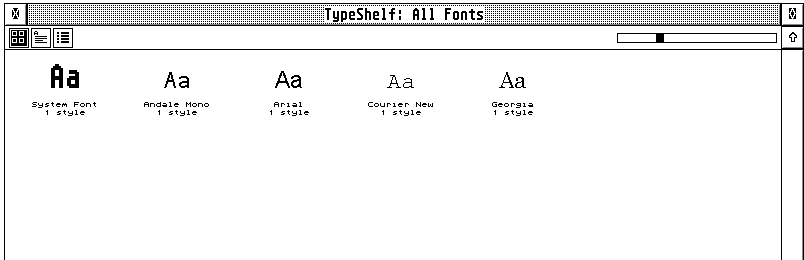</td>
<td>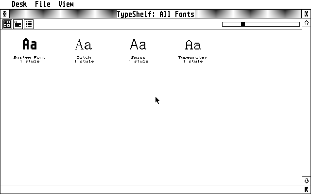</td>
</tr></table>

**Samples**: a pangram in each family.

<table><tr>
<td>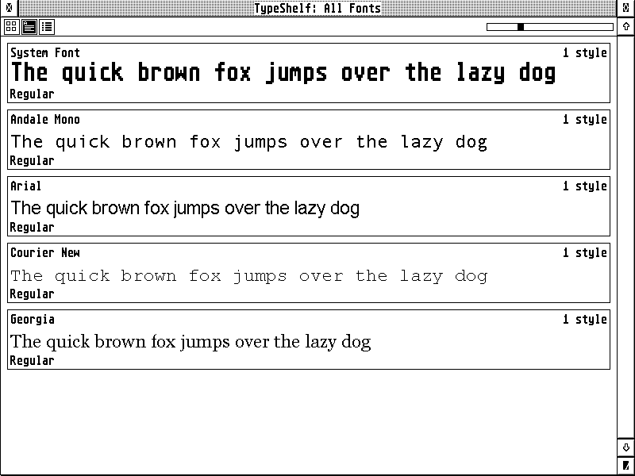</td>
<td>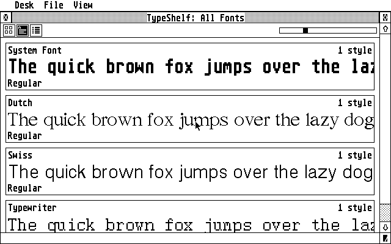</td>
</tr></table>

**List**: a table of families with their number of styles and format; each expands to its styles.

<table><tr>
<td>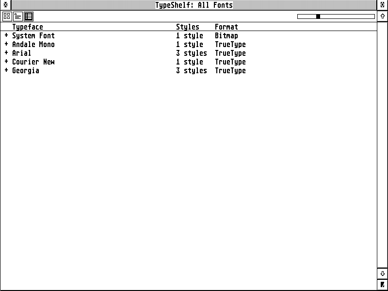</td>
<td>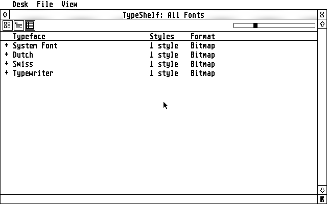</td>
</tr></table>

**Specimen**: one font, with a preview at the zoom size and the font's characters.

<table><tr>
<td>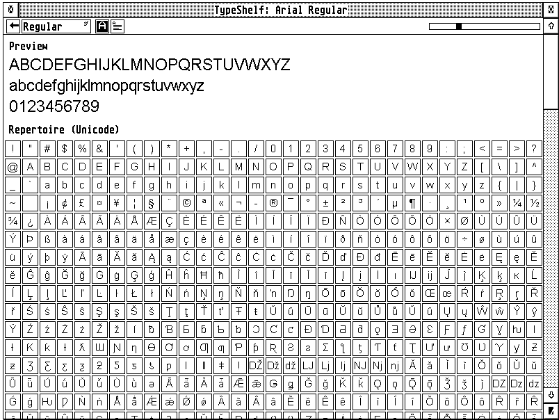</td>
<td>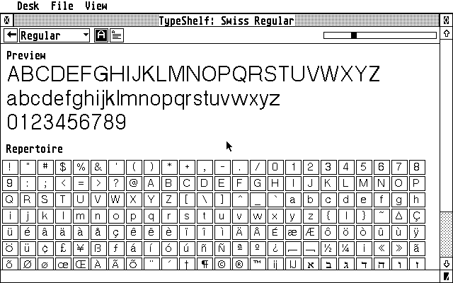</td>
</tr></table>

**A family's Samples**: a card for each style.

<table><tr>
<td>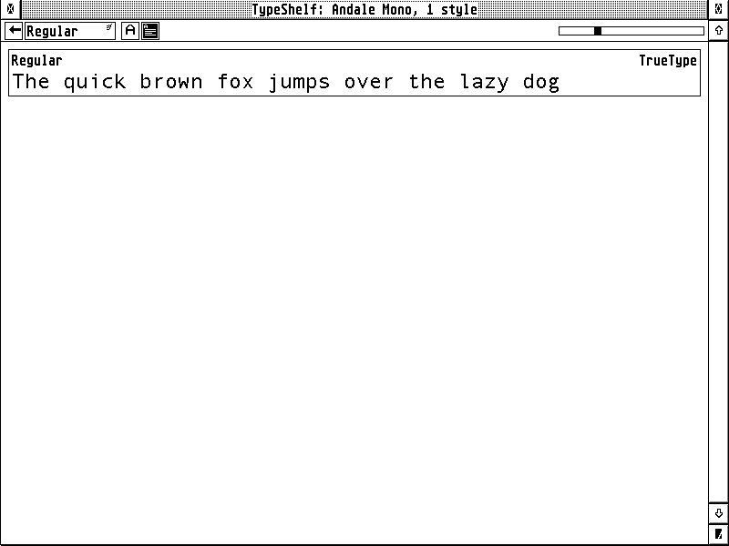</td>
<td>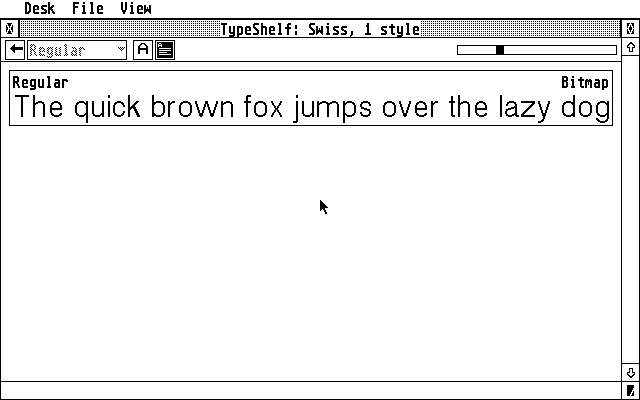</td>
</tr></table>

**About**: the OS, the GDOS and its vector-font variant, the screen, and the font counts and features.

<table><tr>
<td>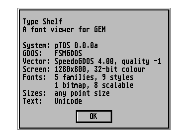</td>
<td>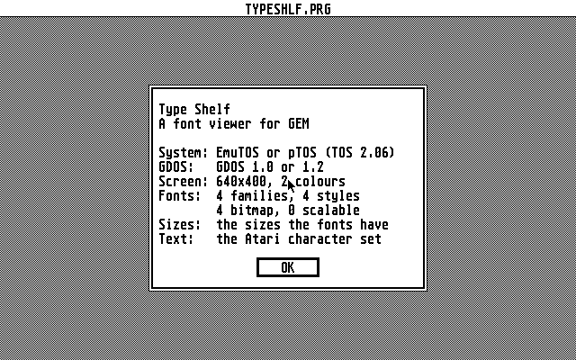</td>
</tr></table>

Licence: GPL-2.0-or-later.
