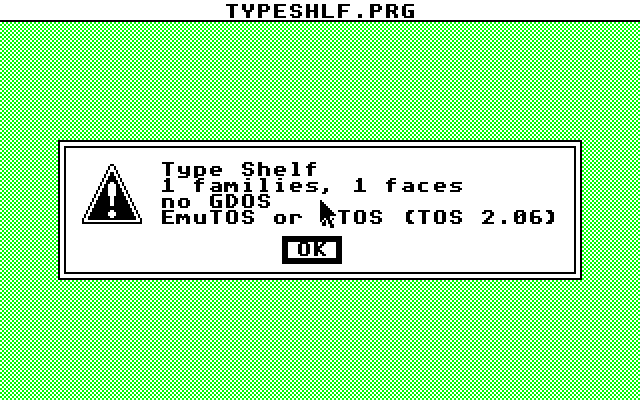

# Type Shelf

A Font Book style font viewer for GEM. It lists the fonts the VDI/GDOS has
installed, grouped by family and style, shows them as icons, samples or a list,
installs new fonts, and reports which VDI/GDOS the machine has.

It targets m68k first (TOS, EmuTOS and [pTOS](https://github.com/kelihlodversson/pTOS)),
built with [gemlib](https://github.com/kelihlodversson/gemlib) and
[libcmini](https://github.com/kelihlodversson/libcmini). ARM builds and links,
and x86 is compile-checked, until gemlib and pTOS can run a GEM application
there.

*Today's build under Hatari on pTOS (m68k, ST low, 320x200): it reads the
installed fonts and reports the GDOS and the OS.  With no GDOS only the system
font is there, hence one family and one face.*

The foundation is in place: the font list, the GDOS and OS decoding, the layout
maths, a real font source over gemlib, and CI. The windows, views, Install Font
and the About dialog are still to come. The design is in
[docs/superpowers/specs/2026-10-20-typeshelf-design.md](docs/superpowers/specs/2026-10-20-typeshelf-design.md).

Licence: GPL-2.0-or-later.
